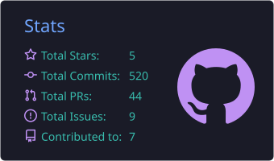
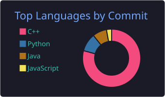

<div align="center">

### 👾 WHAT'S BUZZIN, I'M SASHA 👾

</div>

```ansi
  software engineer (student)
  silent crash
```

<div align="center">
  
</div>

---

## 🛠 `> tech_stack`

<p align="left">
  
</p>

---

## 📊 `> sasha's_stats`

<p align="left">
  
  
</p>

---

## 🐍 `> snake --eat contributions`

<picture>
  <source media="(prefers-color-scheme: dark)"
          srcset="https://raw.githubusercontent.com/al-p-s/al-p-s/output/github-contribution-grid-snake-dark.svg"/>
  <source media="(prefers-color-scheme: light)"
          srcset="https://raw.githubusercontent.com/al-p-s/al-p-s/output/github-contribution-grid-snake.svg"/>
  
</picture>

---

<div align="center">
  
  
</div>

## 📬 `> comms_channel`

<a href="https://t.me/al_p_s">
  
</a>
