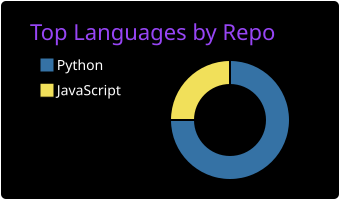
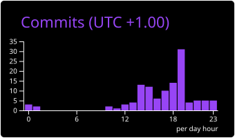
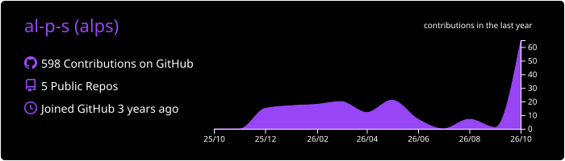

<h3 align="center">👾 WHAT'S BUZZIN, I'M SASHA 👾</h3>

  <code>software engineer (student)</code> 
  <code>silent crash</code>

  
  
  
  
  

<h2 align="center">🛠 <code>&gt; tech_stack</code></h2>

  

<h2 align="center">📊 <code>&gt; sasha's_stats</code></h2>

  
  

  

<h2 align="center">🐍 <code>&gt; snake --eat contributions</code></h2>

  <picture>
    <source media="(prefers-color-scheme: dark)"
          srcset="https://raw.githubusercontent.com/al-p-s/al-p-s/output/github-contribution-grid-snake-dark.svg"/>
    <source media="(prefers-color-scheme: light)"
          srcset="https://raw.githubusercontent.com/al-p-s/al-p-s/output/github-contribution-grid-snake.svg"/>
    
</picture>

<h2 align="center">📬 <code>&gt; comms_channel</code></h2>

  

